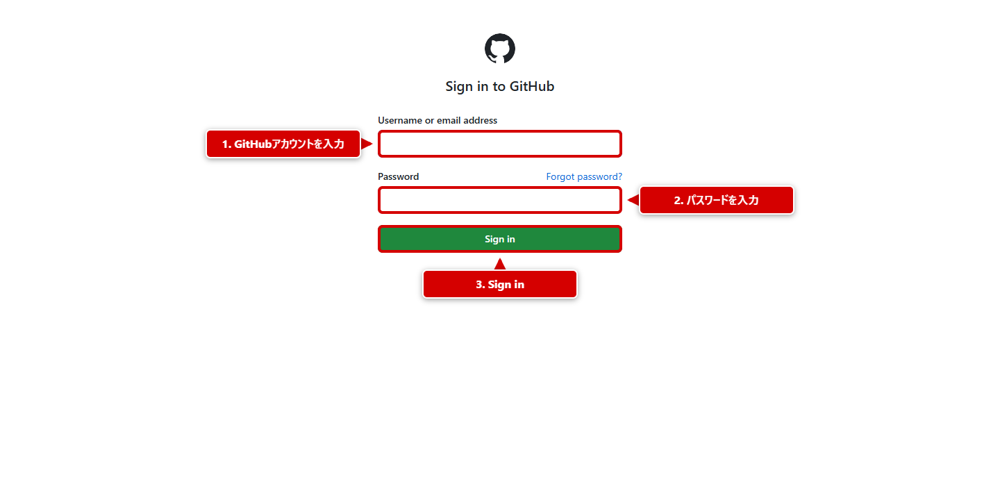
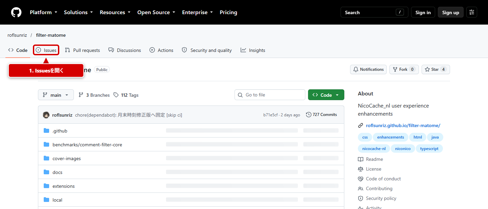
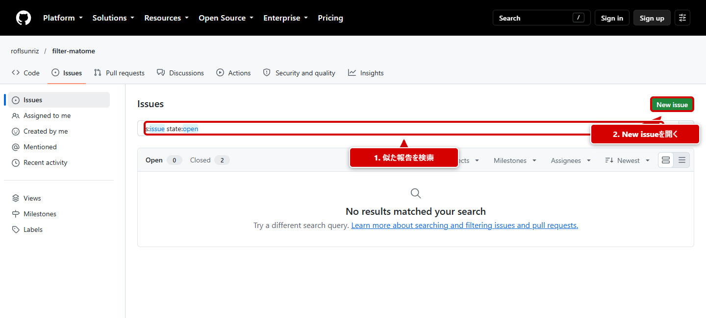

# GitHubでIssueを作成する方法

不具合の報告や機能の提案は、GitHubのIssueから送信できる。GitHubに不慣れな場合も、次の順番で進めればよい。

## 1. 投稿前に用意するもの

- GitHubアカウント。未作成の場合は[GitHub Sign Up](https://github.com/signup)から登録する。
- 不具合を確認した画面、操作、日時のメモ。
- 使用しているfilter-matome、NicoCache_nl、ブラウザー、OSのバージョン。
- 症状が分かるスクリーンショットや短い録画。

!!! danger "秘密情報や個人情報は送信しない"
    Cookie、認証トークン、パスワード、証明書の秘密鍵、署名付き配信URL、ユーザー名やローカルファイルの個人名は、本文・ログ・画像から取り除く。脆弱性は公開Issueへ書かず、[SECURITY.md](https://github.com/roflsunriz/filter-matome/blob/main/SECURITY.md)の窓口を使う。

Issue作成ページを開いたときにサインイン画面が表示された場合は、GitHubアカウントでサインインする。画像内の赤い枠、矢印、ラベルは説明用であり、入力例ではない。



## 2. 同じ内容のIssueを探す

1. [filter-matomeリポジトリ](https://github.com/roflsunriz/filter-matome)を開く。
2. リポジトリ上部の「Issues」を開く。



3. 「Search issues」に症状や機能名を入力する。
4. 同じ内容が見つかった場合は、新しいIssueを作らず、既存Issueへ追加情報を書く。
5. 同じ内容がなければ「New issue」を開く。



!!! note "表示言語や配置が異なる場合"
    GitHubの設定や画面幅により表示言語と配置が変わることがある。「Issues」「Search issues」「New issue」を目印にする。

## 3. 報告の種類を選ぶ

次のリンクから、目的に合うフォームを直接開ける。

[バグレポートを作成](https://github.com/roflsunriz/filter-matome/issues/new?template=bug_report.yml){ .md-button .md-button--primary }
[機能要求を作成](https://github.com/roflsunriz/filter-matome/issues/new?template=feature_request.yml){ .md-button }

- **バグレポート**: 現在の機能が動かない、エラーになる、表示が崩れる場合。
- **機能要求**: 新しい機能や改善案を提案する場合。

迷う場合は、起きている問題ならバグレポート、実装されていない動作の提案なら機能要求を選ぶ。

## 4. バグレポートを書く

タイトルの先頭にはフォームが自動で`[Bug]`を入れる。その後へ、症状が分かる短い要約を書く。

記入例: `[Bug] コメントフィルターのルールを保存できない`

フォームは、分かる範囲で次の順に埋める。

1. **事前確認**: 既存Issueの検索や公開版での確認など、実施できた項目へチェックを入れる。
2. **事前確認できない項目と理由**: 実施できない確認があれば理由を書く。
3. **概要**: 何が起きているかを短く書く。
4. **対象と環境**: ブラウザー、OS、filter-matome、NicoCache_nl、使用中の拡張・フィルター・設定を書く。
5. **再現手順**: ページを開いてから症状が出るまでを番号付きで書く。
6. **期待した結果／実際の結果**: 本来の動作と観測した動作を分けて書く。
7. **診断情報**: スクリーンショット、録画、必要な範囲のログを添付する。画像は入力欄へドラッグ＆ドロップできる。
8. **公開情報の確認**: 秘密情報や個人情報が含まれていないことを確認してチェックする。

### 再現手順の例

```text
1. 視聴ページ https://www.nicovideo.jp/watch/sm... を開く
2. 右下のfilter-matomeメニューを開く
3. コメントフィルターで「保存」を押す
4. 「保存に失敗しました」と表示される
```

「たまに発生する」場合も、発生した日時、頻度、直前の操作を書くと原因を調べやすい。

## 5. 機能要求を書く

タイトルの先頭にはフォームが自動で`[Feature]`を入れる。その後へ、提案を一言で書く。

記入例: `[Feature] コメント検索結果の並び替えを追加する`

- **提案する変更**: 追加・変更したい機能を短く書く。
- **解決したい問題**: 現在どこで困るのか、誰のどの操作を改善したいのかを書く。
- **詳細な説明**: 期待する画面、操作、結果を具体的に書く。
- **UI/UXの提案**: ラフ画像や参考ページがあれば添付する。
- **受け入れ基準**: 何ができれば完了と判断できるかを箇条書きにする。
- **代替案・参考資料・優先度**: 分かる範囲で書く。技術的な実装方法は不明でも問題ない。
- **公開情報の確認**: 秘密情報や個人情報が含まれていないことを確認してチェックする。

## 6. 送信前の確認と送信

- 1つのIssueには1つの問題または提案だけを書く。
- タイトルだけで問題の種類と症状が分かるようにする。
- 再現手順、期待した結果、実際の結果を混ぜずに書く。
- 画像やログにアカウント情報、Cookie、ローカルパスなどが写っていないか見直す。
- フォーム末尾の「Submit new issue」を押す。押すまでは公開されない。

## 7. 作成後にすること

- メンテナーから質問が来た場合は、同じIssueのコメント欄へ返信する。
- 新しい情報は同じIssueへ追記し、同じ内容を再投稿しない。
- 本文を直す場合は、本文右上のメニューから「Edit」を選ぶ。
- 解決したことを確認できたら、その結果と確認したバージョンを書く。

必要事項をすべて埋められなくても、分かる範囲と分からない点を分けて書けばよい。
